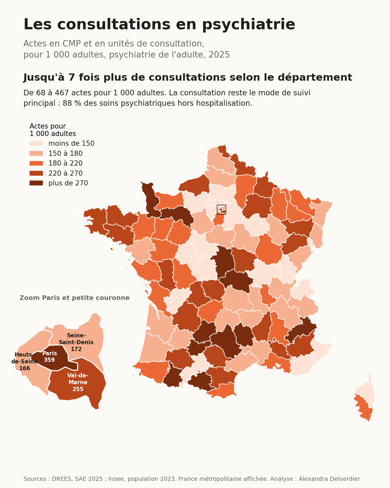
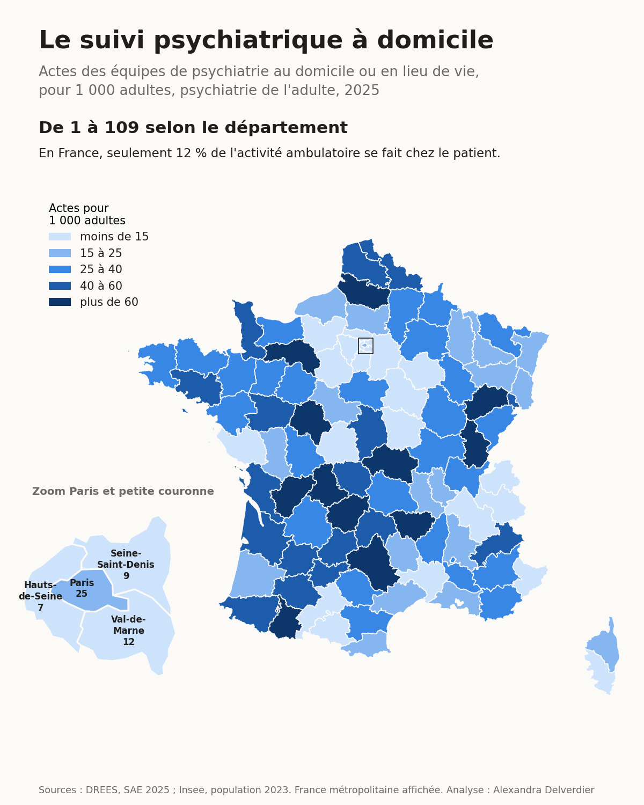
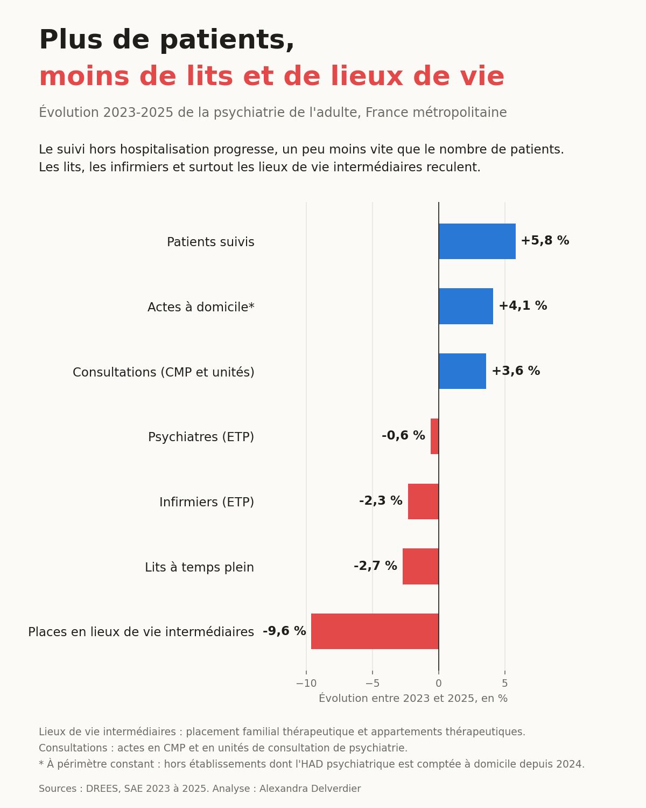

# Accès aux CMP et suivi psychiatrique à domicile en France

Infirmière en psychiatrie, en centre hospitalier, j'ai vu des lits rester occupés faute de relais à la sortie, et des patients revenir quelques semaines plus tard parce que le suivi extérieur n'avait pas pu se mettre en place. Ce projet confronte ce constat de terrain aux données nationales.

**Question** : comment la psychiatrie soigne-t-elle en dehors des murs de l'hôpital, et les départements qui suivent davantage leurs patients en ambulatoire et à domicile ont-ils des lits moins saturés ?

## Résultats (psychiatrie de l'adulte)

### 1. Les consultations existent partout (2025)



- 88 % de l'activité ambulatoire passe par les CMP et les unités de consultation
- De 68 à 467 actes pour 1 000 adultes selon le département, soit un écart d'environ 7 fois

### 2. Le suivi à domicile est le maillon le plus faible (2025)



- Seulement 12 % de l'activité ambulatoire se fait au domicile des patients
- De 1 à 109 actes pour 1 000 adultes selon le département
- Consulter beaucoup ne veut pas dire aller chez les patients : Paris réalise 359 actes de consultation pour 1 000 adultes, mais 25 à domicile

### 3. L'hypothèse de départ n'est pas confirmée à l'échelle du département

Je m'attendais à ce que les départements qui suivent davantage leurs patients à domicile aient des lits moins saturés. Les données ne le montrent pas de façon fiable, ni en comparant les départements entre eux, ni en suivant chaque département dans le temps :

| Lien testé (96 départements de métropole) | Entre départements, 2025 | Variations 2023-2025 au sein de chaque département |
|---|---|---|
| Domicile et occupation des lits | -0,16 (p = 0,11) | +0,17 (p = 0,11) |
| Domicile et part de soins sans consentement | -0,04 (p = 0,68) | |
| Domicile et durée moyenne de séjour | | 0,00 (p = 0,97) |
| Consultations et occupation des lits | -0,11 (p = 0,31) | +0,14 (p = 0,18) |

Corrélations de Spearman. Aucun de ces liens n'est fiable au seuil de 5 %. Les variations du domicile sont calculées à périmètre constant (voir les choix de modélisation).

Ça ne contredit pas l'expérience de terrain : la maille départementale est trop grossière. Pour mesurer l'effet du suivi à la sortie, il faudrait suivre les parcours des patients, et ces données ne sont pas ouvertes.

### 4. Quand les lits manquent, ce sont les soins libres qui reculent (2025)

| Départements classés par lits pour 100 000 adultes | Lits | Journées sans consentement pour 1 000 adultes | Journées en soins libres pour 1 000 adultes | Part sans consentement |
|---|---|---|---|---|
| Quart avec le moins de lits | 63 | 58 | 165 | 26 % |
| Quart avec le plus de lits | 130 | 67 | 362 | 16 % |

- Les journées en soins libres suivent très fortement le nombre de lits (corrélation 0,83, p < 0,001)
- Les journées sans consentement varient peu (corrélation 0,20, p = 0,047)
- La part de contrainte est donc plus élevée là où les lits manquent (-0,44, p < 0,001), mais ce n'est pas la contrainte qui augmente : c'est l'accès à l'hospitalisation libre qui se réduit

Le résultat se confirme dans le temps : entre 2023 et 2025, **les départements qui ont perdu des lits ont aussi perdu des journées en soins libres** (corrélation entre les variations 0,33, p = 0,001). Comparer chaque département à lui-même écarte les explications liées à ses caractéristiques stables, comme sa géographie ou son profil social.

Les patients qui pourraient être hospitalisés librement mais ne trouvent pas de lit sont précisément ceux pour qui le suivi en consultation et à domicile compte le plus.

Les deux liens forts (soins libres et part de contrainte) tiennent quand on retire l'Île-de-France ; le lien faible sur le volume de soins sans consentement, lui, n'est plus significatif (détail dans `analysis/resultats/`). Ce sont des corrélations, pas des relations de cause à effet.

### 5. Entre 2023 et 2025 : plus de patients, moins de lits et de lieux de vie



- Le nombre de patients suivis augmente de 5,8 %, le suivi à domicile de 4,1 % à périmètre constant et les consultations de 3,6 %
- Les lits à temps plein reculent de 2,7 % et les infirmiers de 2,3 % : chaque soignant suit 8 % de patients en plus
- Les places en lieux de vie intermédiaires (placement familial et appartements thérapeutiques) reculent de 9,6 %, alors que ce sont elles qui permettent de sortir de l'hôpital sans revenir directement au domicile
- Les écarts entre départements pour le suivi à domicile restent stables : le département au 90e centile fait environ 8 fois plus d'actes que celui au 10e centile, chaque année

## Architecture

```
archives DREES (SAE 2023, 2024, 2025) + fichier Insee
        │
 scripts/preparer_donnees_brutes.py   extraction, harmonisation des colonnes et de l'encodage, empilement des années
        │
   sources + seeds    chargés dans BigQuery, toutes colonnes en texte
        │
   staging            typage, renommage, une vue par fichier source
        │
 intermediate         psychiatrie de l'adulte par établissement, contrôle de cohérence, population par département
        │
     marts            mart_psy_ambulatoire__departements
        │
   analysis           corrélations, évolutions et visuels (Python, lecture du mart dans BigQuery)
```

| Modèle | Grain |
|---|---|
| `stg_sae__etablissements` | un établissement x une année |
| `stg_sae__psy_activite` | un établissement x une discipline de psychiatrie x une année |
| `stg_sae__psy_modes_legaux` | un établissement x une année |
| `stg_insee__population` | un département x une classe d'âge x une année |
| `int_psy_adulte__etablissements` | un établissement ayant une activité de psychiatrie de l'adulte x une année |
| `int_population_adulte__departements` | un département x une année de la SAE |
| `mart_psy_ambulatoire__departements` | un département x une année |

25 tests dbt : grain de chaque modèle, clés non nulles, valeurs acceptées, proportions entre 0 et 1, population disponible pour chaque année, et une surveillance de la qualité des déclarations.

## Choix de modélisation

- **Discipline GEN plutôt que TOT** : la SAE fournit un total déjà calculé ; on part du détail adulte pour éviter les doubles comptes.
- **Localisation par `DEP_DIFF`** : quand une entité juridique répond pour plusieurs sites, l'activité est rattachée au département où elle a réellement lieu.
- **CMP et unités de consultation regroupés** : certains hôpitaux, surtout les CHU, déclarent une grande part de leur activité en unités de consultation plutôt qu'en CMP (46 % dans l'Hérault). Les séparer créerait un artefact de déclaration.
- **Contrôle de cohérence entre bordereaux** : les journées ventilées par mode légal (PSY2) doivent correspondre aux journées d'hospitalisation déclarées dans PSY. Quand l'écart dépasse un facteur 2, les modes légaux de l'établissement sont écartés. Sans ce contrôle, le CHU de Grenoble, qui déclare 586 847 journées dans PSY2 en 2024 contre environ 9 500 dans PSY, fausserait à lui seul la tendance nationale. Entre 20 et 29 établissements sont écartés chaque année, soit 1,5 à 1,6 % des journées d'hospitalisation adulte : certains n'ont pas rempli PSY2, d'autres y déclarent des chiffres incohérents.
- **Rupture de série sur le domicile en 2024** : avec la réforme des autorisations d'activité de soins, l'hospitalisation à domicile (HAD) psychiatrique n'est plus comptée comme du temps complet mais comme des actes à domicile. Les 15 établissements qui avaient une HAD en 2023 voient leurs actes à domicile augmenter de 25 % entre 2023 et 2025, contre 4 % pour les autres. Le modèle repère ces établissements (`concerne_reforme_had`) et le mart fournit une série à périmètre constant (`actes_domicile_perimetre_constant`), utilisée pour toutes les comparaisons entre années. Sans cette correction, la hausse du domicile serait de 5,5 % au lieu de 4,1 %.
- **Années empilées dès les données brutes** : les noms de colonnes (minuscules en 2023 et 2024, majuscules en 2025) et l'encodage (Latin-1 puis UTF-8) changent selon les millésimes. Le script de préparation les harmonise ; toutes les transformations métier restent dans dbt.
- **Données brutes chargées en texte**, typées dans le staging : les codes FINESS commencent par un zéro qui disparaîtrait avec une détection automatique des types.
- **Population par année** : chaque année de la SAE prend la dernière estimation Insee disponible ; ajouter une nouvelle estimation ne demande aucun changement de code.
- **Corrélation de Spearman** : basée sur les rangs, elle résiste aux valeurs extrêmes et ne suppose pas de relation linéaire entre des départements très hétérogènes.
- **Une année à la fois pour les corrélations entre départements** : empiler les trois années compterait chaque département trois fois et gonflerait artificiellement la significativité. Les évolutions sont testées sur les variations 2023-2025, une observation par département.
- **Volumes et parts** : une part de soins sans consentement peut varier parce que les soins libres changent. Les deux sont calculés pour ne pas confondre les effets.

## Limites

- La SAE ne sépare pas le personnel du CMP de celui de l'hospitalisation : les ETP couvrent toute la psychiatrie de l'établissement.
- Il n'existe pas de données nationales ouvertes sur les délais d'attente en CMP.
- Les patients peuvent être soignés hors de leur département, ce qui influence les ratios, surtout en Île-de-France.
- Les modes légaux de soins (bordereau PSY2) ne sont pas ventilés entre adultes et enfants.
- La population de référence est celle de 2023 pour les trois années, dernière estimation par classe d'âge disponible dans le fichier utilisé. Les évolutions de population sont faibles sur la période, mais les taux pour 1 000 adultes de 2024 et 2025 sont légèrement surestimés.
- En 2023, la SAE ne renseigne pas l'isolement ni les équipes mobiles pour personnes âgées.
- Les actes à domicile de 2025 (carte et indicateurs de l'année) incluent l'ancienne HAD psychiatrique de 14 établissements. Les comparaisons entre années utilisent la série à périmètre constant.
- Quelques valeurs sont à interpréter avec prudence, par exemple le Territoire de Belfort, qui déclare 0,1 % de soins sans consentement en 2025.

## Sources

- DREES, Statistique annuelle des établissements de santé (SAE) 2023, 2024 et 2025, bases statistiques
- Insee, estimations de population au 1er janvier par département, sexe et grande classe d'âge

## Stack

BigQuery · dbt Core · SQL · Python (pandas, SciPy, GeoPandas, Matplotlib)
